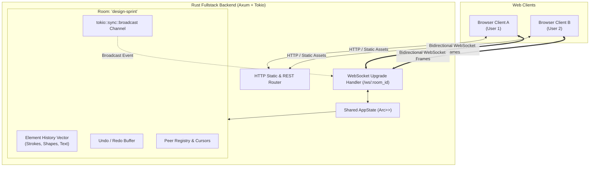
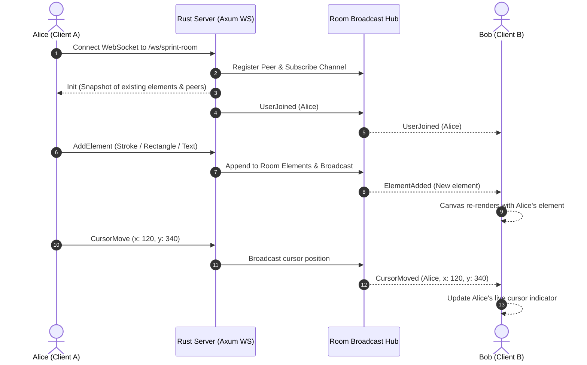
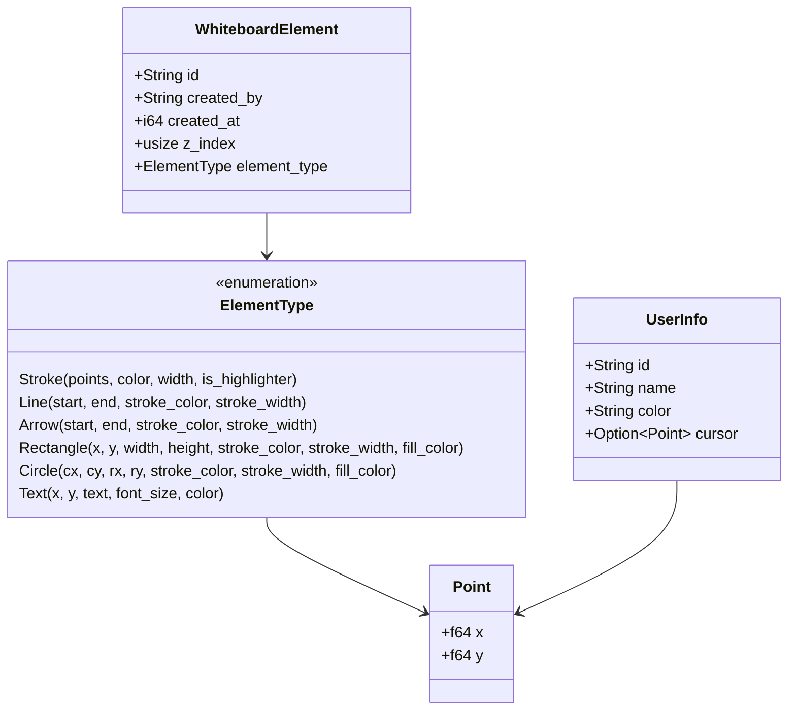

# RustBoard — Realtime Collaborative Whiteboard

[](https://www.rust-lang.org/)
[](LICENSE)
[](https://github.com/tokio-rs/axum)
[](https://tokio.rs/)

**RustBoard** is a fast, lightweight, and fully functional real-time collaborative whiteboard written in Rust. It combines a high-performance asynchronous Rust backend powered by Axum and Tokio with a zero-dependency HTML5 Canvas web client. It compiles into a single, self-contained executable that serves both the WebSocket real-time engine and the embedded web frontend.

---

## Architecture Overview



### Realtime Collaboration Sequence



---

## Table of Contents

- [1. Tutorial: Getting Started](#1-tutorial-getting-started)
- [2. How-To Guide: Common Tasks](#2-how-to-guide-common-tasks)
- [3. Reference: Technical Specifications](#3-reference-technical-specifications)
- [4. Explanation: Deep Architecture & Design](#4-explanation-deep-architecture--design)

---

## 1. Tutorial: Getting Started

This tutorial guides you through installing dependencies, compiling the project, launching the whiteboard server, and testing real-time collaboration with multiple browser windows.

### Prerequisites

Ensure you have Rust and Cargo installed:

```bash
rustc --version
cargo --version
```

If you do not have Rust installed, install it using `rustup`:

```bash
curl --proto '=https' --tlsv1.2 -sSf https://sh.rustup.rs | sh
```

### Step 1: Clone the Repository

Navigate to your workspace directory:

```bash
cd /home/muklis/Documents/exploring/PROJECTS/realtime-whiteboard-1-2-3
```

### Step 2: Build the Application

Compile the server in release mode for optimal performance:

```bash
cargo build --release
```

Or for development:

```bash
cargo build
```

### Step 3: Run the Application

Start the whiteboard server:

```bash
cargo run
```

You will see the startup banner:

```text
🎨 ========================================================
   RustBoard — Realtime Collaborative Whiteboard
   Listening on: http://0.0.0.0:3000
   Local URL:    http://localhost:3000
   Health Check: http://localhost:3000/api/health
========================================================
```

### Step 4: Open and Draw

1. Open your browser to [http://localhost:3000](http://localhost:3000).
2. Select the **Pen tool** (`P`) from the floating dock on the left.
3. Choose a color and stroke size from the top bar.
4. Click and drag on the canvas to draw.
5. To test multi-user collaboration, open a new Incognito window or another browser tab at [http://localhost:3000](http://localhost:3000).
6. Draw in one window: strokes, shapes, and live mouse cursors immediately synchronize across all participants in real time.

---

## 2. How-To Guide: Common Tasks

### How to Change Port and Host

By default, RustBoard binds to `0.0.0.0:3000`. You can configure the port and host via CLI flags:

```bash
# Listen on port 8080
cargo run -- --port 8080

# Listen on a specific IP address and port
cargo run -- --host 127.0.0.1 --port 5000
```

### How to Create and Share Collaboration Rooms

RustBoard provides isolated whiteboard rooms:

1. **Via URL**: Append `?room=<name>` to the URL:
   - `http://localhost:3000/?room=architecture-review`
   - `http://localhost:3000/?room=team-standup`
2. **Via Friendly URL path**:
   - `http://localhost:3000/room/product-roadmap`
3. **Via In-App Switcher**: Click the room badge in the top bar to open the room modal, enter a new room name, and click **Enter Room**.
4. **Copy Link**: Click the **Copy Room Link** button (📋 icon) to copy the exact URL to your clipboard and share it with collaborators.

### How to Use Whiteboard Tools and Shortcuts

| Tool | Icon / Name | Shortcut | Usage |
|------|-------------|----------|-------|
| ✏️ | Pen | `P` or `1` | Freehand drawing with Bézier curve smoothing |
| 🖌️ | Highlighter | `H` or `2` | Semi-transparent highlighter stroke |
| 📏 | Straight Line | `L` or `3` | Click and drag to draw a line |
| ➡️ | Arrow | `A` or `4` | Click and drag to create a directional arrow |
| 🔲 | Rectangle | `R` or `5` | Draw rectangular frames with stroke and fill |
| ⭕ | Circle / Ellipse | `C` or `6` | Draw circles or ellipses with stroke and fill |
| 📝 | Text Note | `T` or `7` | Click anywhere on canvas to type and hit `Enter` |
| 🧽 | Eraser | `E` or `8` | Click or drag over an element to delete it |
| ✋ | Pan / Hand | `Space` / Drag | Pan across the infinite canvas |
| 🔍 | Zoom | `Ctrl` + Scroll / `+` / `-` | Zoom in and out centered at mouse cursor |
| ↩️ | Undo | `Ctrl` + `Z` | Revert the last drawn element |
| 🔁 | Redo | `Ctrl` + `Y` | Restore undone elements |
| 💾 | Export PNG | `Ctrl` + `S` | Instant high-resolution PNG export |

### How to Export and Import Whiteboards

- **Export as PNG**: Click **Export** &rarr; **Export as PNG**. Computes the bounding box of all elements and exports a clean, high-resolution raster image.
- **Export as SVG**: Click **Export** &rarr; **Export as SVG**. Generates standard scalable vector graphics suitable for vector graphics editors like Figma or Inkscape.
- **Save JSON Snapshot**: Click **Export** &rarr; **Save Snapshot (.json)** to back up the complete board state.
- **Import JSON Snapshot**: Click **Import** and select any previously saved `.json` snapshot to restore elements into your room.

### How to Query the REST API

RustBoard provides REST endpoints for health checks, room metrics, and external integration:

```bash
# Health check
curl -s http://localhost:3000/api/health | jq .

# List all active rooms and collaborator counts
curl -s http://localhost:3000/api/rooms | jq .

# Fetch all elements in a room
curl -s http://localhost:3000/api/rooms/default/elements | jq .

# Clear a room remotely
curl -X POST http://localhost:3000/api/rooms/default/clear

# Export room state as JSON
curl -s http://localhost:3000/api/rooms/default/export -o room-backup.json

# Import room state
curl -X POST http://localhost:3000/api/rooms/default/import \
  -H "Content-Type: application/json" \
  -d @room-backup.json
```

### How to Run Automated Tests

Execute the automated test suite verifying state management, undo/redo mechanics, REST endpoints, and static asset serving:

```bash
cargo test
```

### How to Deploy via Systemd or Docker

#### Using Docker:

```dockerfile
FROM rust:1.75-slim as builder
WORKDIR /app
COPY . .
RUN cargo build --release

FROM debian:bookworm-slim
WORKDIR /app
COPY --from=builder /app/target/release/realtime-whiteboard /app/realtime-whiteboard
EXPOSE 3000
CMD ["/app/realtime-whiteboard", "--host", "0.0.0.0", "--port", "3000"]
```

Build and run:

```bash
docker build -t realtime-whiteboard .
docker run -p 3000:3000 realtime-whiteboard
```

---

## 3. Reference: Technical Specifications

### CLI Options

| Argument | Short | Long | Default | Description |
|----------|-------|------|---------|-------------|
| Host | `-H` | `--host` | `0.0.0.0` | Network interface to bind to |
| Port | `-p` | `--port` | `3000` | Port number to listen on |
| Help | `-h` | `--help` | — | Display CLI usage information |
| Version | `-V` | `--version` | — | Display version information |

### REST API Endpoints

| Method | Endpoint | Description | Response Status |
|--------|----------|-------------|-----------------|
| `GET` | `/api/health` | Health metrics (uptime, active rooms, users) | `200 OK` |
| `GET` | `/api/rooms` | Array of active room summaries | `200 OK` |
| `GET` | `/api/rooms/:room_id/elements` | Array of all elements in the room | `200 OK` or `404` |
| `GET` | `/api/rooms/:room_id/export` | Complete room JSON snapshot | `200 OK` or `404` |
| `POST` | `/api/rooms/:room_id/import` | Import an array of elements | `200 OK` |
| `POST` | `/api/rooms/:room_id/clear` | Clear all elements in the room | `200 OK` |

### WebSocket Protocol Specification

All WebSocket communication occurs over `ws://<host>:<port>/ws/<room_id>`. Messages are encoded as JSON objects.

#### Client &rarr; Server Messages

1. **`Join`**: Sent upon opening connection.
   ```json
   {
     "type": "Join",
     "user_id": "user_xyz123",
     "user_name": "Alice",
     "user_color": "#3b82f6"
   }
   ```
2. **`AddElement`**: Sent when a new stroke, shape, or text item is finished.
   ```json
   {
     "type": "AddElement",
     "element": {
       "id": "elem_123",
       "created_by": "user_xyz123",
       "created_at": 1717281600000,
       "z_index": 0,
       "element_type": {
         "type": "rectangle",
         "x": 100.0,
         "y": 150.0,
         "width": 200.0,
         "height": 120.0,
         "stroke_color": "#1e293b",
         "stroke_width": 4.0,
         "fill_color": null
       }
     }
   }
   ```
3. **`CursorMove`**: Throttled live cursor updates in canvas coordinates.
   ```json
   { "type": "CursorMove", "x": 145.2, "y": 289.0 }
   ```
4. **`DeleteElement`**: Erase an element by its ID.
   ```json
   { "type": "DeleteElement", "id": "elem_123" }
   ```
5. **`Clear`**: Clear the room canvas.
   ```json
   { "type": "Clear" }
   ```
6. **`Undo` / `Redo`**: Revert or restore actions.
   ```json
   { "type": "Undo" }
   { "type": "Redo" }
   ```
7. **`Ping`**: Heartbeat frame.
   ```json
   { "type": "Ping" }
   ```

#### Server &rarr; Client Messages

- `Init`: Sent to joining client with room snapshot: `{ "type": "Init", "your_id": "...", "room_id": "...", "elements": [...], "users": [...] }`
- `ElementAdded`: Broadcast when an element is created: `{ "type": "ElementAdded", "element": { ... } }`
- `ElementUpdated`: Broadcast when an element is modified: `{ "type": "ElementUpdated", "element": { ... } }`
- `ElementDeleted`: Broadcast when an element is deleted: `{ "type": "ElementDeleted", "id": "..." }`
- `BoardCleared`: Broadcast when board is cleared: `{ "type": "BoardCleared" }`
- `UserJoined`: Broadcast when a new peer joins: `{ "type": "UserJoined", "user": { ... } }`
- `UserLeft`: Broadcast when a peer disconnects: `{ "type": "UserLeft", "user_id": "..." }`
- `CursorMoved`: Broadcast remote cursor position: `{ "type": "CursorMoved", "user_id": "...", "x": 145.2, "y": 289.0 }`
- `Pong`: Keepalive response: `{ "type": "Pong" }`

### Data Models



### Dependencies

- **`axum` (v0.7)**: Ergonomic, hyper-based web framework for routing and WebSocket handling.
- **`tokio` (v1.37)**: Asynchronous multi-threaded runtime.
- **`tower-http` (v0.5)**: CORS middleware and tracing integrations.
- **`serde` & `serde_json` (v1.0)**: High-speed serialization and deserialization.
- **`clap` (v4.5)**: Command line argument parsing with derive macros.
- **`uuid` (v1.8)**: Unique client and element identifier generation.
- **`chrono` (v0.4)**: UTC timestamping.
- **`tracing` & `tracing-subscriber` (v0.3)**: Structured logging.

---

## 4. Explanation: Deep Architecture & Design

### Concurrency Model & State Synchronization

RustBoard follows an asynchronous, actor-inspired message-passing architecture:

1. **Thread-Safe Shared State**: The central application state (`AppState`) wraps `HashMap<String, Room>` inside an `Arc<RwLock<...>>`. Read operations (fetching elements, listing rooms, health status) acquire shared read locks (`.read()`), ensuring high read throughput without contention. Write operations (adding elements, clear, cursor mutations) acquire exclusive write locks (`.write()`) only for the minimal duration needed to update in-memory vectors.
2. **Channel-Based Realtime Broadcasting**: Each collaborative room maintains a `tokio::sync::broadcast::Sender<ServerMessage>`. When a client connects to `/ws/:room_id`, the server creates a receiver via `room.tx.subscribe()`. When any user performs an action (drawing a stroke, moving their mouse, or undoing), the action is processed by the state manager and broadcast to all active subscribers.
3. **Echo Prevention & Low Overhead**: The outgoing loop filters out local cursor move events so clients do not waste CPU processing their own cursor echoes. Cursor movements are throttled to ~25 updates per second to minimize network bandwidth while maintaining smooth 60fps visuals on the client.

### Infinite Canvas & Coordinate Transformations

The canvas operates on an infinite 2D plane:
- **World (Canvas) Space**: All element positions (`Point { x, y }`, widths, heights) are stored in continuous world coordinates.
- **Screen Space**: The physical pixels on the user's viewport.
- **Transform Math**:
  $$\text{CanvasX} = \frac{\text{ScreenX} - \text{PanX}}{\text{Zoom}}$$
  $$\text{CanvasY} = \frac{\text{ScreenY} - \text{PanY}}{\text{Zoom}}$$
When drawing, zooming, or panning, the HTML5 Canvas 2D context is transformed using `ctx.translate(panX, panY)` and `ctx.scale(zoom, zoom)`. High-DPI screens (Retina) are handled automatically by scaling the backing store with `window.devicePixelRatio`.

### Self-Contained Deployment with Embedded Assets

RustBoard bundles all web frontend assets (`index.html`, `style.css`, `app.js`) directly into the compiled Rust binary using `include_str!`. 
- **Standalone Binary**: You can copy the generated binary `target/release/realtime-whiteboard` to any server or Docker image without needing a `static/` directory or Node.js environment.
- **Developer Mode**: During development, the static file server checks if `./static` exists on disk. If found, it reads directly from disk, allowing live frontend modifications without recompiling the Rust code.

---

## License

This project is licensed under the [MIT License](LICENSE).
